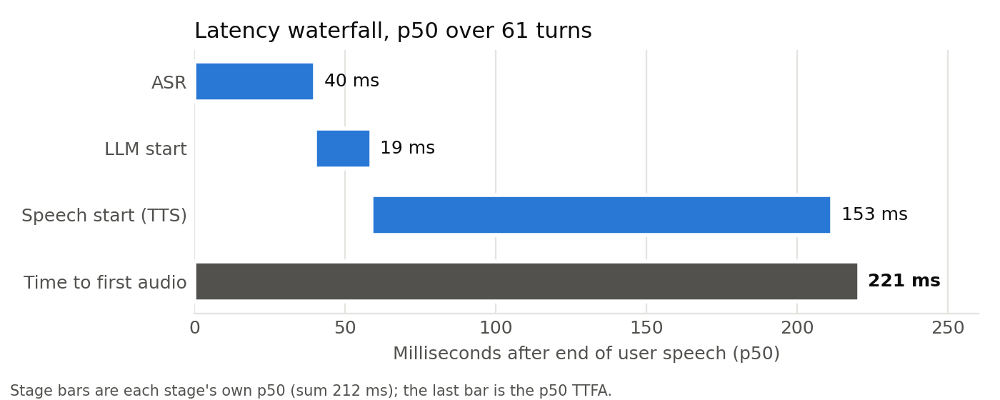

# Assignment 4 report: Hartwell Voice Assistant

**Partners:** Anusha Saha, asaha66 and Yu Wang, ywang3174

**Models:** LLM Llama 3.2 3B Instruct (`meta-llama/Llama-3.2-3B-Instruct`, served with vLLM); ASR faster-whisper small.en (`Systran/faster-whisper-small.en`, float16 on the GPU); TTS Piper, en_US lessac medium voice (on the CPU)

**Run behind the figures:** PACE-ICE job 7166576; 8 CPU cores and 1 NVIDIA H100 80GB; 61 turns; trace file `run_output/7166576/trace.jsonl`

## 1. The system

The pipeline is ASR → LLM → TTS. 

The LLM streams its response, and completed sentences are queued to Piper’s voice on CPU while generation continues. ASR waits for the full utterance, and TTS starts once the first complete sentence is available. We manage to reduce latency by buffering LLM text and sending the sentence to Piper when sentence boundary detected, which can begin speaking while the LLM continues generating. Before timing, the agent warms up ASR, TTS, and the LLM with a dummy synthesized audio and asks the LLM for a short “ready” response, so the initialization is outside the measured turns. 

 
## 2. The latency waterfall



*Figure 1. p50 of each stage on the TTFA path over 61 turns; the last bar is the p50 TTFA.*

| | p50 (ms) | p95 (ms) |
|---|---|---|
| **TTFA, all turns** |221 |342 |
| ASR: `asr_final` minus `end_of_user_speech` |40|56 |
| LLM start: `llm_first_token` minus `asr_final` |19 |22 |
| Speech start: `tts_first_audio` minus `llm_first_token` |153 |270 |
| Not on the TTFA path: `llm_complete` minus `llm_first_token` |94 |313 |

Turns counted: 61 of 61.


**How I treat stages that overlap:** The LLM streams its reply and as soon as the first full sentence arrives, it is sent to Piper on a separate thread while the LLM keeps generating. So Speech start includes both waiting for that first sentence to finish and Piper producing its first audio. The rest of the LLM generation overlaps with speaking and is not on the TTFA path. It appears only in the last row of the table, not in the figure. The figure shows the p50 of each stage.

**How to recompute these numbers:** From the repository root:

```bash
PYTHONPATH=. python3 plot_waterfall.py run_output/7166576/trace.jsonl
```

It checks every turn with `voice_kit`'s `record_problems`, prints this table with `summarize_stages`, and redraws Figure 1.


## 3. Word error rate on our own voices

| Speaker | Utterances | Reference words | Pooled WER | Mean WER per utterance |
|---|---|---|---|---|
| Yu Wang | 41| 343| 0.0641| 0.0764|
| Anusha Saha | 20| 139|0.0072 |0.0050 |


On these recordings, ASR handled Yu’s voice worse, especially words like "the" and people's names. 

 In Yu Wang 's recording: 

    said : what time does the makerspace open today 

    heard: what time does the makerspace open the day 


The reason might be the accent and the speed of speaking. "to" in "today" sounds very light and fast, so ASR transcribed incorrectly. 


## 4. The bottleneck

**The dominant stage:**

Speech start stage takes the largest share, TTFA(p50) = 227. Its own p50 is 156, and its share of the total is 156/227 = 0.687 

 

**Why:**

For the same run, we also measured p50 and p95 for other stages (47 ms for ASR and 21 ms for LLM start), so both speech recognition and LLM initialization are completed in a short time. Also we have observed shorter response took shorter time than longer response. For example, speech start time of the response "Booked." Is 49ms, but a longer response listing available rooms does not start speech until 200ms. 

Then the reason for taking too much time between LLM first token and TTS is that LLM is generating response tokens one by one like we usually observe. 
 

**The fix I would ship next:** 

Modify the boundary definition of sentence so it triggers the TTS on commas and semicolons as well. This can further reduce the time before starting the first tts speech and p50 decreases, because we observed LLM tends to use long compound sentences.
 

**One thing I tried that did not help:** 
We set max length of buffering text, when the max length set is large, it does not change p50 or p90 too much, but when the meax length set is small, it breaks the natural rhythm and intonation, generating very unnatural audio responses. (like peo-ple, w-ant) 

## 5. Reproducing this

The seed is 42, set with `--seed 42` in `recipe/run_agent.sbatch`. 

The dependency versions are pinned in `recipe/requirements.txt`. 

To reproduce, go to the top folder of the unzipped submission and run the commands below to build the image, which is built under ~/scratch with the current settings. Then run sbatch, and the output trace will be under `run_output/<JOB_ID>/trace.jsonl`. 

 
Commands in bash:
````bash

cd CAI4   # the top folder of the unzipped submission

export SCRATCH_DIR="$HOME/scratch" 

mkdir -p "$SCRATCH_DIR/cache" "$SCRATCH_DIR/tmp" 

export APPTAINER_CACHEDIR="$SCRATCH_DIR/cache" 

export APPTAINER_TMPDIR="$SCRATCH_DIR/tmp" 
  
apptainer build --fakeroot "$SCRATCH_DIR/agent.sif" recipe/agent.def 

sbatch recipe/run_agent.sbatch 

```` 

Once the job is completed, the output trace will be under `run_output/<JOB_ID>/trace.jsonl`. 

## Appendix: AI-use disclosure 

**Tools used:** Team member Anusha Saha used Claude (Opus), and Team member Yu Wang used Gemini 3.1 and Copilot.

**What for:** 
Team member Anusha Saha used Claude to write the latency fixes in `your_agent.py` (Piper thread count set from the job's CPUs, full warm-up, TTS on its own thread, offline Whisper loading, keeping the run going when a turn fails), which took TTFA from 3.0 s (job 7041996) to about 0.2 s; write the deterministic room-availability and timer code that gives the LLM a ROOM CHECK/TIMERS line each turn, write a script to generate the latency waterfall figure, and generate recording transcripts. 

Team member Yu Wang used Copilot to build the outline of function for agent, and used Gemini 3.1 to generate recording transcripts.

**What I wrote or decided myself:** 
Team member Anusha Saha wrote report section 3's table and section 2's table.

Team member Yu Wang wrote report questions (1,5, parts of 2,3,4)

**How I checked it:** 

For the recording transcripts, Yu Wang and Anusha Saha checked if the number and quality of transcripts satisfy the tasks requirements.
We compared the results of traces for different runs after modifying the agent code. We checked the response and transcripts recorded in the traces, and looked into the traces that failed carefully.

 

 
